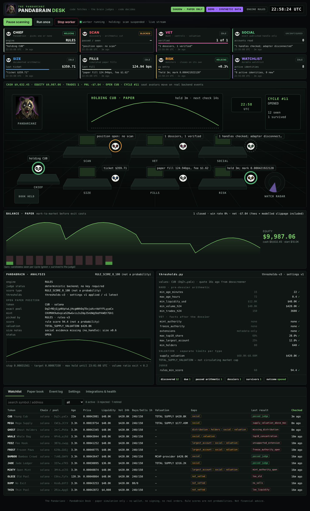
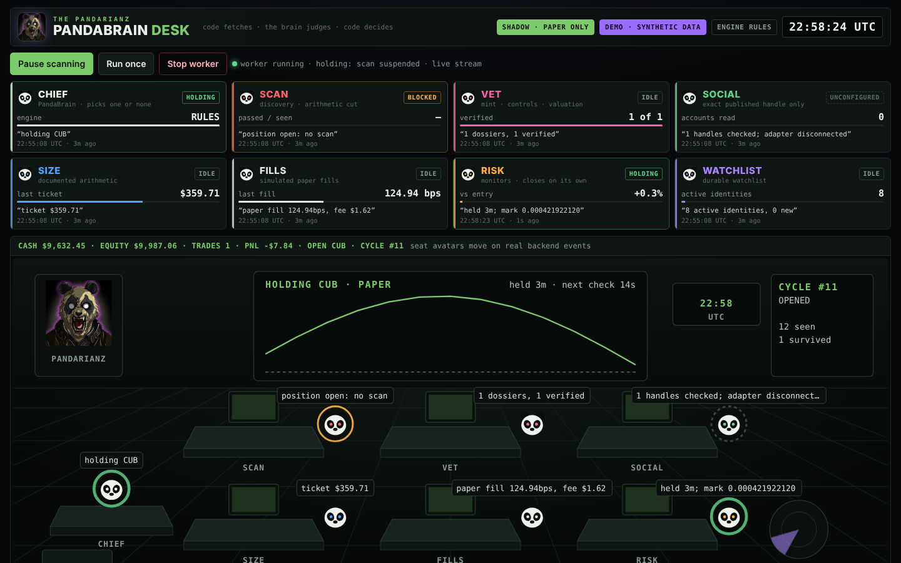
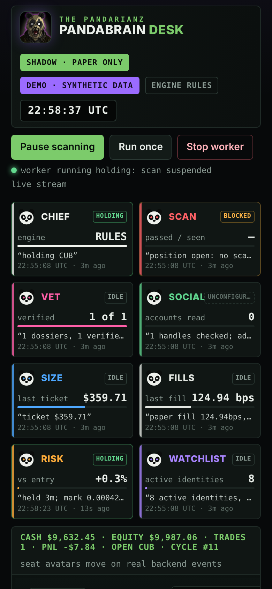

# The Pandarianz | PandaBrain Desk — v3.0.0

A local **SHADOW / PAPER-ONLY** bot trading desk. Six deterministic seats (SCAN, VET, SOCIAL, SIZE,
FILLS, RISK) are coordinated by CHIEF (PandaBrain). They discover fresh Solana pools, verify mints,
value them honestly, judge them, and run **simulated** paper trades in a local SQLite book. A
dashboard backed by real APIs shows every seat, decision, rejection and fill.

> **No real execution exists.** There is no wallet, signing, swap, approval or order code, and no
> setting that enables any of them. Live execution requests are refused server-side.
> This project is separate from the XAU/BTC Pandarianz AI Trading Terminal and touches none of its
> processes, databases, cohorts or strategies.



---

## Important: what this build is based on

The brief asked for `pandarianz-pandabrain-desk-v2-2.zip` to be extended. **That ZIP was not
attached to the build session** (only the reference video and the panda artwork were). v3 is
therefore a **clean re-implementation** of the v2.2 behaviour as described in the brief:
GeckoTerminal discovery, DEX Screener quotes with exact GeckoTerminal pool fallback, verified Solana
mint controls (including metadata-only Token-2022), deterministic rules, SQLite ledger, one paper
position, leases, rejection cooldowns, risk monitoring and a CLI. The 52 v2.2 tests could not be run
because their code was not available. See [MIGRATION.md](MIGRATION.md) for what this means for an
existing v2.2 `desk.db`.

---

## Mac quick start (copy-paste)

Requires macOS with Python **3.10+** (`python3 --version`). Homebrew Python works:
`brew install python@3.12`. Nothing else is installed: the runtime uses the standard library only.

```bash
# 1. unpack and enter
cd ~/Downloads
unzip pandarianz-pandabrain-desk-v3.0.0.zip
cd pandarianz-pandabrain-desk-v3.0.0

# 2. one-time setup (creates .env, migrates both books)
./scripts/setup.sh

# 3a. try the synthetic DEMO desk first (fictional tokens, separate book, DEMO badge)
./scripts/start.sh --demo
#     open http://127.0.0.1:8765/  then press "Start scanning" or "Run once"

# 3b. or run against PUBLIC data (GeckoTerminal / DEX Screener / Solana RPC)
./scripts/start.sh
#     open http://127.0.0.1:8765/

# stop: Ctrl+C in that terminal, or from another terminal:
./scripts/stop.sh            # public desk
./scripts/stop.sh --demo     # demo desk

# run the offline test suite
./scripts/test.sh
```

If Python reports an SSL certificate error on python.org builds, run
`/Applications/Python\ 3.*/Install\ Certificates.command` once.

Other CLI commands:

```bash
python3 -m pandabrain run-once [--demo]          # one cycle (or one RISK check when holding)
python3 -m pandabrain status [--demo]            # JSON summary
python3 -m pandabrain export-events --format csv # event log, no secrets
python3 -m pandabrain serve --port 8800 --no-worker
```

Optional configuration lives in `.env` (see `.env.example`): `SOLANA_RPC_URL`,
`TYPESAFE_API_KEY`, Telegram opt-in. Keys stay server-side and are never sent to the browser.

---

## Rules vs AI, in plain words

| | **RULES** (default) | **TYPED_AI** (optional) |
|---|---|---|
| What decides | Deterministic code in `pandabrain/judges/rules.py` | A real model answering typed questions (noul / choice / score) via the TypeSafe `systemone` API |
| Key needed | No | `TYPESAFE_API_KEY` in `.env` |
| Output | **Rule score 0–100. Not a probability.** A transparent sum of five capped components (liquidity depth, buy/sell balance, volume alive, float spread, holder base) | Model probabilities, validated (bounds, sums, all answers present, choice ∈ options, versioned model ID) |
| If unavailable | Always available | The desk shows **UNCONFIGURED / unavailable** and records a no-trade. **It never falls back to RULES** and never manufactures probabilities from rule scores |

The six seats are **deterministic workers, not separate AI agents.** In TYPED_AI mode only the
CHIEF/judge step calls a model. Code fetches, the judge judges, code decides: every number the
judge sees is computed by the desk first, and thresholds are applied in code.

The TYPED_AI contract was checked against the published Python SDK source (`typesafe-sdk` 0.7.4 on
PyPI): `POST {base}/v1/systemone`, Bearer auth, body `{state, model, questions}`, response
`{model, answers, usage}`. The docs site could not be reached from the build environment, and **no
live TypeSafe call was made** (no key was available). Pricing and rate limits were deliberately not
copied from the guide; check your own console.

---

## How a cycle works

```
SCAN    GeckoTerminal new_pools (bounded pages)  ──►  durable watchlist (chain, pool, token)
        due entries re-quoted by EXACT pool (GT pools/multi)
        pre-dossier arithmetic: price, freshness, age, liquidity, volume, real trades, sells
        (market cap is NOT checked here any more)
VET     bounded dossiers (max_dossiers_per_cycle):
        GT token info → Solana RPC mint (jsonParsed + raw base64; must agree)
        → mint/freeze authority, Token-2022 extensions → distribution / holders / largest account
        → VALUATION gate (below)
SOCIAL  exact project-published handle only (GT token info). Adapter disconnected → gap recorded
CHIEF   RULES or TYPED_AI judge → one pick or a recorded no-trade reason
SIZE    cash × 6% × size_factor (no social → ×0.60), ≤ 2% of pool, fee-floor check
FILLS   fresh exact-pool re-quote (DEX Screener pair, GT pool fallback) → simulated paper fill
RISK    marks the exact pool every risk_poll_seconds; stop / target / max hold / volume fade;
        unmeasurable → CLOSE_PENDING until a real exit price exists. Book released only in the
        same transaction that records the simulated close.
```

While a position is held **there is no scan at all**; RISK keeps running even if discovery is paused.

### Valuation policy (new in v3)

The latest public diagnostic showed 18/19 candidates rejected for `missing_mcap_usd`. v3 fixes the
pipeline without inventing numbers:

- **`PROVIDER_MARKET_CAP`** — a valid market cap reported by the quote provider. Preferred when present; its provider is recorded.
- **`TOTAL_SUPPLY_VALUATION`** — `price × (raw_supply / 10**decimals)`, computed with `Decimal`
  from the verified mint (parsed and raw views must agree). Recorded with source, timestamps, raw
  supply, decimals and the derivation string. **This is not circulating market cap**, `mcap_usd`
  stays null, and it is gated by its **own** limits (`supply_valuation_min_usd` /
  `supply_valuation_max_usd`). This is a **new eligibility policy**, made explicit.
- Provider FDV is never used as market cap.
- EVM candidates are rejected as `evm_unverified` until verified controls and valuation exist for them.

### Distinct rejection reasons (examples)

`stale_quote`, `too_young`, `too_old`, `low_liquidity`, `low_volume`, `low_trades`, `no_sells`,
`evm_unverified`, `rpc_unavailable`, `token_info_unavailable`, `mint_missing`, `mint_view_mismatch`,
`unsupported_program`, `unsupported_extension`, `mint_authority_open`, `freeze_authority_open`,
`missing_distribution`, `missing_holders`, `top10_concentration`, `largest_account_concentration`,
`valuation_unavailable`, `valuation_invalid`, `mcap_below_min/above_max`,
`supply_valuation_below_min/above_max`, `judge_unconfigured`, `judge_unavailable`,
`judge_schema_error`, `not_worth_trading`, `low_pick_confidence`, `size_fee_floor`, `slippage_over_max`.

### Cooldowns that can't hide a fix

Cooldowns are keyed by exact pool and timed by the check that fired. Each row records its stage
policy (`pre@3`, `vet@3`, …) and, for threshold reasons, the settings version. Rows from an older
policy, rows voided by a settings change, and **retired v2.2 reasons (`missing_mcap_usd`)** are
ignored automatically. Nothing is bulk-deleted.

### Watchlist

Every discovered identity is stored and re-quoted as it matures. A `too_young` entry wakes exactly
when it reaches `min_age_minutes`. Discovery stays bounded (`new_pool_pages`, `recheck_batch`,
per-cycle request budgets, a per-minute GeckoTerminal limiter, 429 back-off). A provider outage is
reported on the dashboard, and the watchlist is kept.

---

## Dashboard

The layout mirrors the reference video (see [docs/VIDEO_MAPPING.md](docs/VIDEO_MAPPING.md)):
header with mode badges and a UTC clock; 4×2 seat cards; a desk floor where seat avatars move, glow
and hand off on **real backend events**; a paper balance chart; a PandaBrain analysis panel; a live
`thresholds.py` panel with ✓/✗ against the focused candidate; a funnel; and tabs for the sortable
watchlist (click a row for the token drawer), the paper book, a searchable/exportable event log,
versioned settings, and integrations & health.

The **SHADOW · PAPER ONLY** badge is always visible. **DEMO · SYNTHETIC DATA** appears only on the
demo book, which is a separate database file that refuses to open as the public book (and the
reverse). Empty states stay empty: no fake profit history, no sample data posing as live.

Screenshots in `docs/screenshots/` were captured from a live **demo** book after about 16 minutes
of real worker activity: one closed paper trade (BAMBOO, max hold, −$7.84 net of fees and
slippage), then CUB, a token first rejected as `too_young`, matured on the watchlist and was picked.
Files: `desktop.png` / `desktop-top.png`, `mobile.png` / `mobile-top.png` (390 px), `drawer.png`
(JADE: `TOTAL_SUPPLY_VALUATION` evidence), `book.png`, `eventlog.png`, `settings.png`, `health.png`.

| Desktop | Mobile |
|---|---|
|  |  |

---

## Completed vs disconnected

**Completed and working**
- Discovery → watchlist → exact-pool quotes → pre-dossier arithmetic → bounded VET → valuation gate
- Solana mint verification: parsed/raw agreement, authorities, Token-2022 extension allow-list (metadata-only)
- `TOTAL_SUPPLY_VALUATION` with Decimal, separate limits; provider market cap preferred
- Policy-aware cooldowns, durable watchlist with maturation, request budgets and rate limiting
- RULES judge; TYPED_AI adapter with strict validation and no fallback (code complete, tested against a contract fake)
- SIZE arithmetic; paper FILLS with modelled fees/slippage; RISK with exact-pool continuity, restart-safe, CLOSE_PENDING
- One position at a time (schema-enforced), idempotent open/close, leases renewed through expensive work
- Versioned settings applied at cycle boundaries; transactional migrations with backups; demo/public isolation
- Local dashboard with SSE, controls, duplicate-action protection, CSRF/Host/Origin checks, sanitised errors
- Telegram adapter (Bot API `sendMessage`): opt-in only, suppressed during tests

**Disconnected or not implemented (shown as such in the UI)**
- **FOMO**: no public documented API; browser-session extraction is deliberately not done
- **Grok bots / X reads (SOCIAL)**: no implemented, documented read adapter; social evidence is recorded as missing and size is cut
- **TYPED_AI live calls**: unverified against the live service (no key, and the API host was unreachable from the build environment)
- **Live execution**: blocked. Real trading would need a separate, authorised implementation with verified venue APIs, idempotency, reconciliation, fee evidence and signing. None of that exists here.
- Robinhood / BSC / Base / ETH: discovered if enabled, then rejected (`evm_unverified`)

---

## Security notes

Binds `127.0.0.1` (refuses other addresses unless `PANDABRAIN_ALLOW_REMOTE=1`). Every request is
Host-checked (DNS-rebinding protection). Mutations are POST + JSON, need the per-run
`X-Desk-Token` that is injected into the page, and refuse foreign `Origin` or cross-site
`Sec-Fetch-Site`. A strict CSP is set (no inline script). Bodies are size-limited and validated.
Static files are path-confined. No route runs commands. Errors and logs are sanitised (Bearer
tokens, `ts-` keys, Telegram bot tokens and `api-key=` query values are redacted), and RPC URLs are
shown by host only. Token names and descriptions are untrusted text: they are rendered with
`textContent`, never sent as instructions, and kept out of judge states except as labelled data.

---

## Tests

- `./scripts/test.sh` — **65 offline tests** (stdlib `unittest`, fixture transport, no network).
  They cover raw supply/decimal scaling, invalid supply/decimals/non-finite values, provider market
  cap preference, distinct valuation labels, unsupported extensions, missing concentration, provider
  outages, watchlist maturation, exact-pool continuity across restart, stale data, one-position
  enforcement, lease collisions, no scanning while held, idempotent open/close, empty stats,
  demo/public isolation, live-execution blocking, TYPED_AI schema validation, no fallback, settings
  versioning, the HTTP API, CSRF and the event stream.
- `tests/browser/smoke.mjs` — browser smoke test: starts a demo server, clicks **Run once**, waits
  for real backend changes in the DOM, opens the drawer and tabs, checks for horizontal overflow at
  390 px, and saves screenshots.
  `cd tests/browser && npm ci && npx playwright install chromium && node smoke.mjs`

**Live public-data checks were not run.** The build sandbox's network policy blocked GeckoTerminal,
DEX Screener, Solana RPC and TypeSafe (HTTP 403 at the proxy). Parsers follow the providers'
documented response shapes and are exercised through fixtures, but the first public run on your
Mac is the first real-world validation. Watch **Integrations & health → Providers** on that run.
